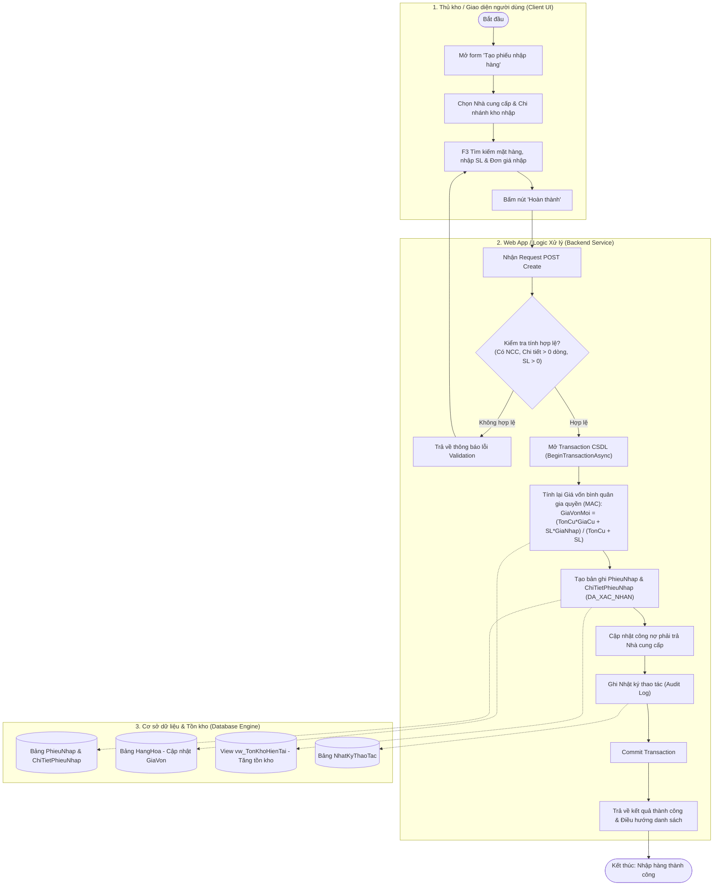
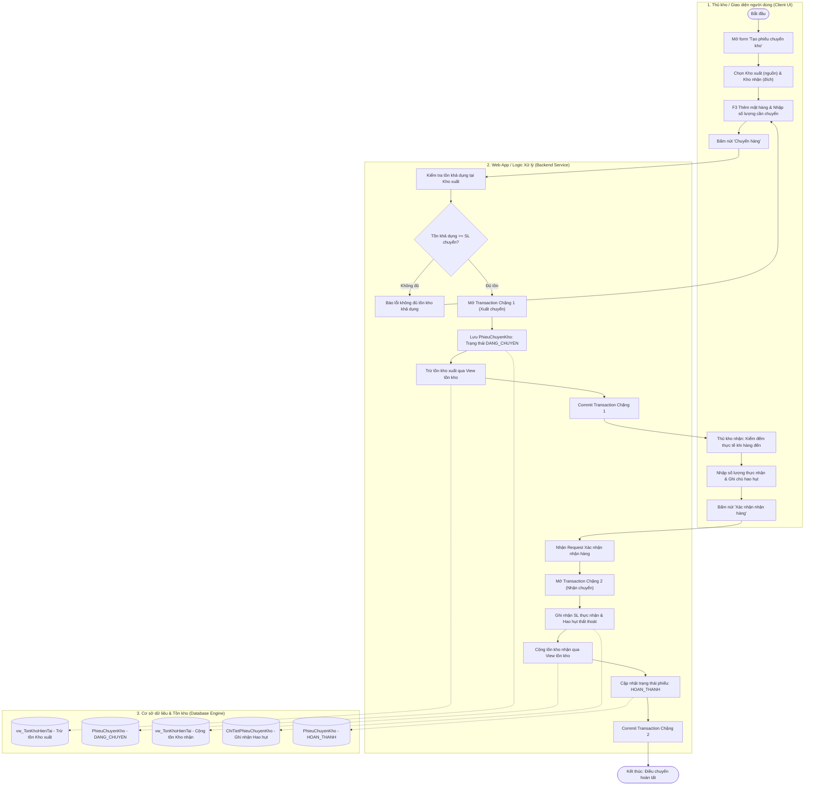
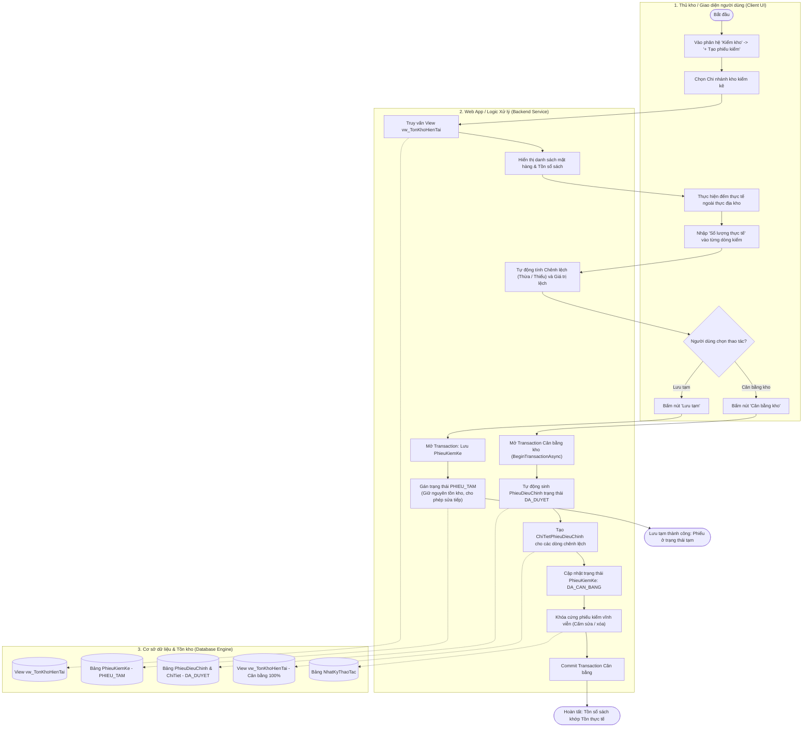
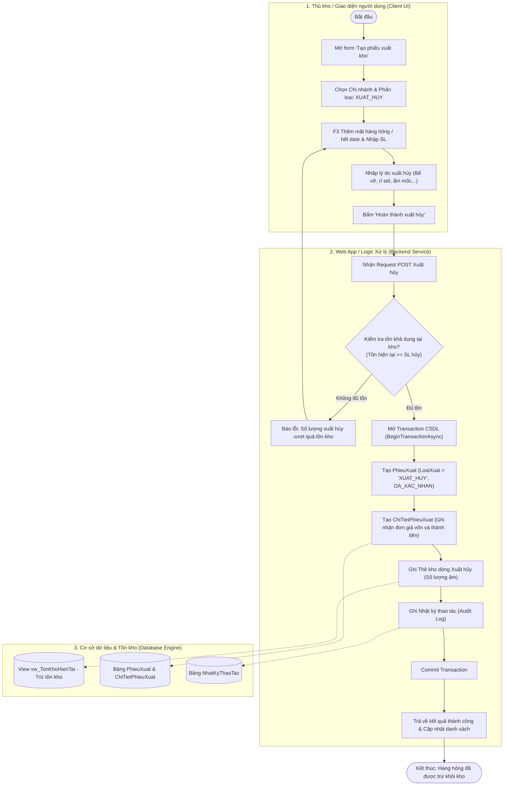
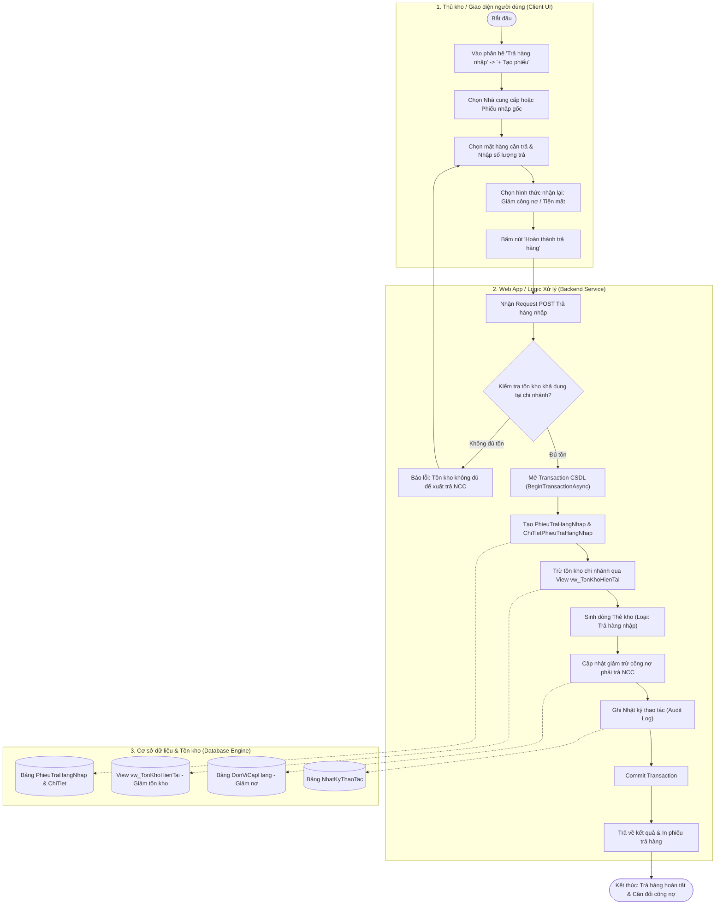

# Tài Liệu Thiết Kế Luồng Xử Lý Nghiệp Vụ (Activity Diagrams)
## Hệ Thống Quản Lý Kho Hàng Phú Quốc (`QuanLyKhoPhuQuocLTW`)

> **Mục đích tài liệu**: Chuẩn hóa toàn bộ các luồng hoạt động nghiệp vụ cốt lõi theo chuẩn UML 2.5 với phân làn trách nhiệm (Swimlanes 3 tầng: *Client/UI* - *Web App/Service* - *Database/Transaction*), phục vụ báo cáo học thuật LaTeX, bảo vệ đồ án và tham chiếu mã nguồn.

---

## 1. Quy Trình Nhập Hàng Từ Nhà Cung Cấp & Cập Nhật Giá Vốn (MAC)

### 1.1. Biểu đồ hoạt động (Mermaid)

---

## 2. Quy Trình Điều Chuyển Hàng Hóa Liên Chi Nhánh (2 Chặng)

### 2.1. Biểu đồ hoạt động (Mermaid)

---

## 3. Quy Trình Kiểm Kê & Tự Động Cân Bằng Kho

### 3.1. Biểu đồ hoạt động (Mermaid)

---

## 4. Quy Trình Xuất Hủy Hàng Hỏng & Hết Hạn Sử Dụng

### 4.1. Biểu đồ hoạt động (Mermaid)

---

## 5. Quy Trình Trả Hàng Nhập Cho Nhà Cung Cấp

### 5.1. Biểu đồ hoạt động (Mermaid)

