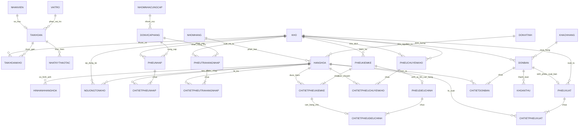
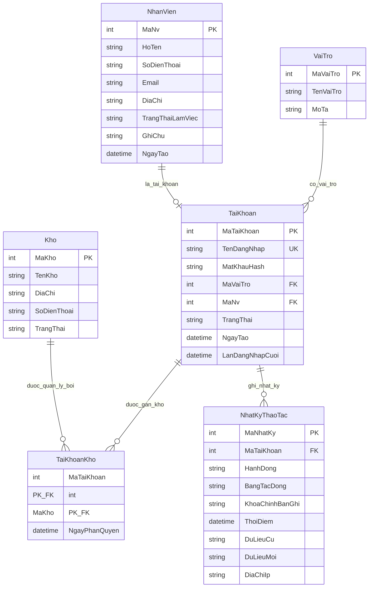
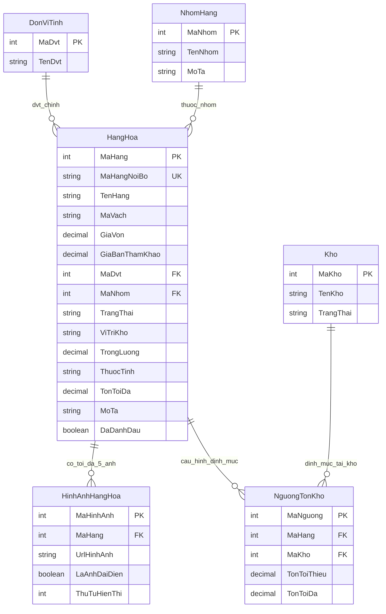
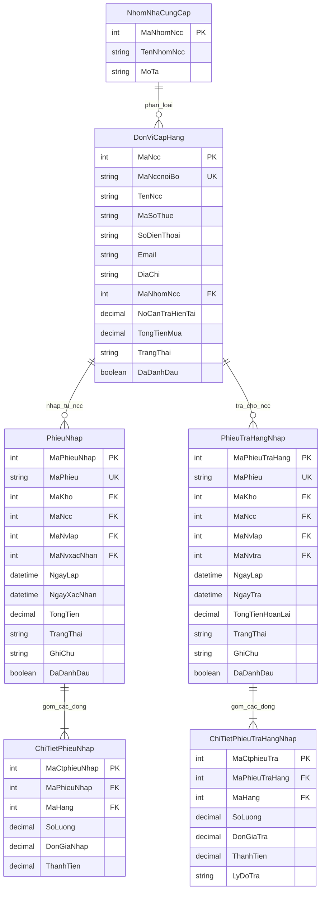
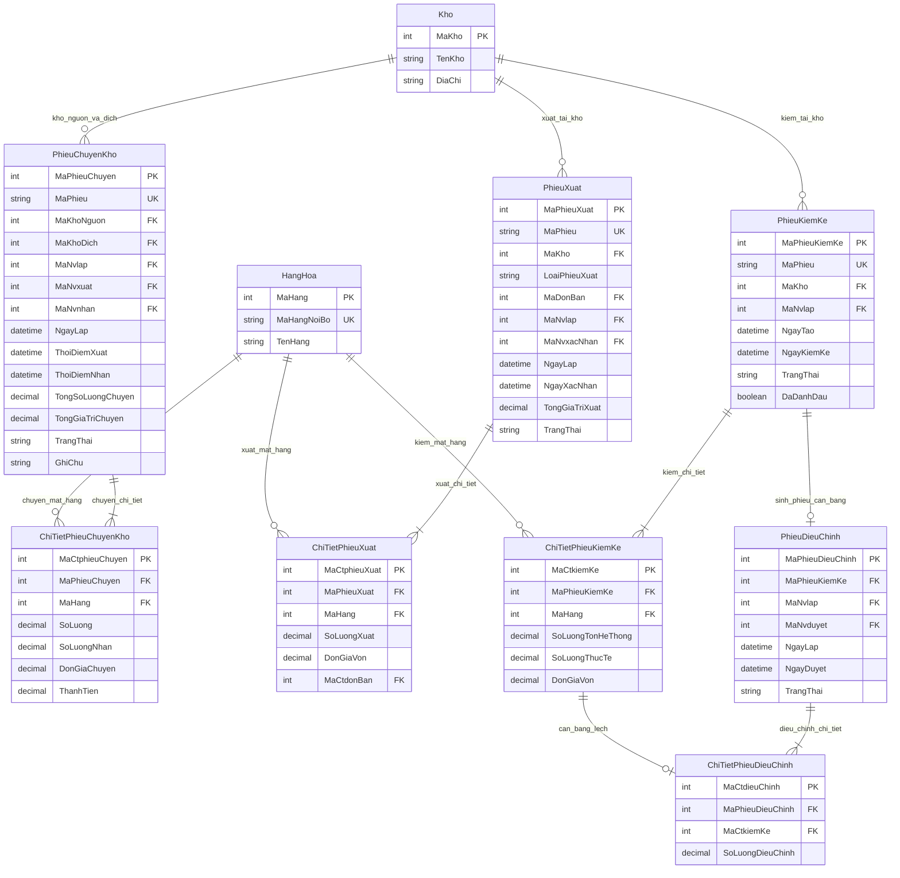
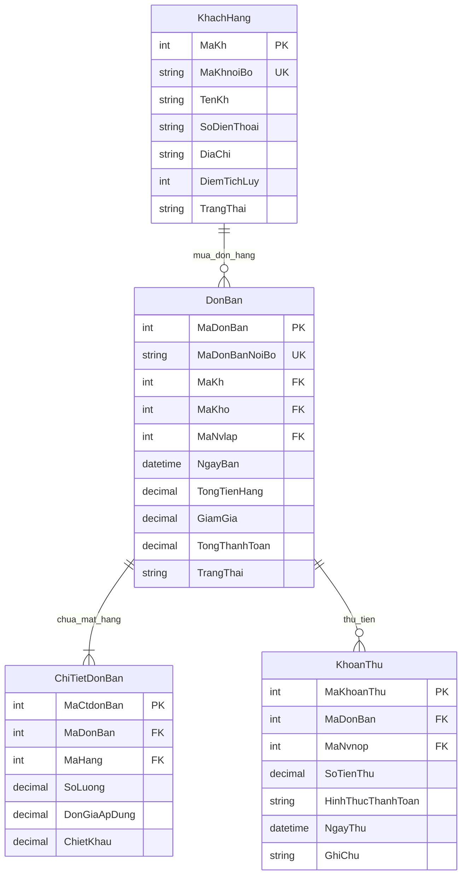

# Sơ Đồ Thực Thể - Mối Quan Hệ (ERD) & Lược Đồ Quan Hệ (RM)
## Hệ Thống Quản Lý Kho Hàng Phú Quốc (`QuanLyKhoPhuQuocLTW`)

> **Mục đích tài liệu**: Cung cấp tài liệu mô hình hóa dữ liệu chính xác 100% theo chuẩn học thuật (Đại học GTVT / Đồ án Lập trình Web) và chuẩn công nghiệp, phục vụ báo cáo LaTeX, bảo vệ đồ án và tra cứu phát triển.

---

# PHẦN 1: SƠ ĐỒ THỰC THỂ - MỐI QUAN HỆ (ERD - ENTITY RELATIONSHIP DIAGRAM)

## 1.1. Sơ Đồ ERD Tổng Thể Mức Khái Niệm (Conceptual Level)

Sơ đồ thể hiện cách các cụm thực thể liên kết với nhau qua các mối quan hệ nghiệp vụ chính:

---

## 1.2. Sơ Đồ ERD Phân Rã Chi Tiết Theo Cụm Nghiệp Vụ

### Cụm 1: Quản Trị Hệ Thống, Nhân Sự & Phân Quyền Kho (RBAC)

---

### Cụm 2: Danh Mục Hàng Hóa, Định Mức Tồn & Đơn Vị Tính

---

### Cụm 3: Chuỗi Cung Ứng (Nhập Hàng & Trả Hàng Nhà Cung Cấp)

---

### Cụm 4: Luân Chuyển Hàng Hóa, Xuất Hủy & Kiểm Kê - Cân Bằng Kho

---

### Cụm 5: Bán Hàng & Quản Lý Dòng Tiền (Khách Hàng & Khoản Thu)

---

# PHẦN 2: LƯỢC ĐỒ QUAN HỆ (RELATIONAL MODEL - RM)

## 2.1. Biểu Diễn Hình Thức Toán Học (Mathematical Relational Schema)

Theo quy ước chuẩn của học phần Cơ sở Dữ liệu & Lập trình Web:
- **Tên quan hệ (Lược đồ)**: Chữ in hoa đứng đầu.
- **$\underline{\text{Thuộc tính gạch chân}}$**: Khóa chính (Primary Key - PK).
- **Thuộc tính in nghiêng có dấu sao ($\text{\textit{ThuocTinh}}^\ast$)**: Khóa ngoại (Foreign Key - FK).
- **Thuộc tính gạch chân nét đứt ($\underline{\underline{\text{Thuộc tính}}}}$)**: Thuộc tính vừa là Khóa chính vừa là Khóa ngoại (Composite PK/FK).

---

### 1. Phân Hệ Quản Trị Hệ Thống & Phân Quyền
1. $\text{VAITRO} (\underline{\text{MaVaiTro}}, \text{TenVaiTro}, \text{MoTa})$
2. $\text{NHANVIEN} (\underline{\text{MaNv}}, \text{HoTen}, \text{SoDienThoai}, \text{Email}, \text{DiaChi}, \text{TrangThaiLamViec}, \text{GhiChu}, \text{NgayTao})$
3. $\text{TAIKHOAN} (\underline{\text{MaTaiKhoan}}, \text{TenDangNhap}, \text{MatKhauHash}, \text{\textit{MaVaiTro}}^\ast, \text{\textit{MaNv}}^\ast, \text{TrangThai}, \text{NgayTao}, \text{LanDangNhapCuoi})$
4. $\text{TAIKHOANKHO} (\underline{\underline{\text{MaTaiKhoan}}}^\ast, \underline{\underline{\text{MaKho}}}^\ast, \text{NgayPhanQuyen})$
5. $\text{NHATKYTHAOTAC} (\underline{\text{MaNhatKy}}, \text{\textit{MaTaiKhoan}}^\ast, \text{HanhDong}, \text{BangTacDong}, \text{KhoaChinhBanGhi}, \text{ThoiDiem}, \text{DuLieuCu}, \text{DuLieuMoi}, \text{DiaChiIp})$

### 2. Phân Hệ Danh Mục & Thiết Lập Kho
6. $\text{KHO} (\underline{\text{MaKho}}, \text{TenKho}, \text{DiaChi}, \text{SoDienThoai}, \text{TrangThai}, \text{NgayTao})$
7. $\text{DONVITINH} (\underline{\text{MaDvt}}, \text{TenDvt})$
8. $\text{NHOMHANG} (\underline{\text{MaNhom}}, \text{TenNhom}, \text{MoTa})$
9. $\text{HANGHOA} (\underline{\text{MaHang}}, \text{MaHangNoiBo}, \text{TenHang}, \text{MaVach}, \text{GiaVon}, \text{GiaBanThamKhao}, \text{\textit{MaDvt}}^\ast, \text{\textit{MaNhom}}^\ast, \text{TrangThai}, \text{ViTriKho}, \text{TrongLuong}, \text{ThuocTinh}, \text{TonToiDa}, \text{MoTa}, \text{DaDanhDau}, \text{NgayTao}, \text{NgayCapNhat})$
10. $\text{HINHANHHANGHOA} (\underline{\text{MaHinhAnh}}, \text{\textit{MaHang}}^\ast, \text{UrlHinhAnh}, \text{LaAnhDaiDien}, \text{ThuTuHienThi})$
11. $\text{NGUONGTONKHO} (\underline{\text{MaNguong}}, \text{\textit{MaHang}}^\ast, \text{\textit{MaKho}}^\ast, \text{TonToiThieu}, \text{TonToiDa})$

### 3. Phân Hệ Đối Tác & Khách Hàng
12. $\text{NHOMNHACUNGCAP} (\underline{\text{MaNhomNcc}}, \text{TenNhomNcc}, \text{MoTa})$
13. $\text{DONVICAPHANG} (\underline{\text{MaNcc}}, \text{MaNccNoiBo}, \text{TenNcc}, \text{MaSoThue}, \text{SoDienThoai}, \text{Email}, \text{DiaChi}, \text{\textit{MaNhomNcc}}^\ast, \text{NoCanTraHienTai}, \text{TongTienMua}, \text{TrangThai}, \text{DaDanhDau}, \text{NgayTao})$
14. $\text{KHACHHANG} (\underline{\text{MaKh}}, \text{MaKhNoiBo}, \text{TenKh}, \text{SoDienThoai}, \text{DiaChi}, \text{DiemTichLuy}, \text{TrangThai})$

### 4. Phân Hệ Giao Dịch Chứng Từ Nhập - Trả - Xuất - Chuyển - Kiểm
15. $\text{PHIEUNHAP} (\underline{\text{MaPhieuNhap}}, \text{MaPhieu}, \text{\textit{MaKho}}^\ast, \text{\textit{MaNcc}}^\ast, \text{\textit{MaNvLap}}^\ast, \text{\textit{MaNvXacNhan}}^\ast, \text{NgayLap}, \text{NgayXacNhan}, \text{TongTien}, \text{TrangThai}, \text{GhiChu}, \text{DaDanhDau})$
16. $\text{CHITIETPHIEUNHAP} (\underline{\text{MaCtphieuNhap}}, \text{\textit{MaPhieuNhap}}^\ast, \text{\textit{MaHang}}^\ast, \text{SoLuong}, \text{DonGiaNhap}, \text{ThanhTien})$
17. $\text{PHIEUTRAHANGNHAP} (\underline{\text{MaPhieuTraHang}}, \text{MaPhieu}, \text{\textit{MaKho}}^\ast, \text{\textit{MaNcc}}^\ast, \text{\textit{MaNvLap}}^\ast, \text{\textit{MaNvTra}}^\ast, \text{NgayLap}, \text{NgayTra}, \text{TongTienHoanLai}, \text{TrangThai}, \text{GhiChu}, \text{DaDanhDau})$
18. $\text{CHITIETPHIEUTRAHANGNHAP} (\underline{\text{MaCtphieuTra}}, \text{\textit{MaPhieuTraHang}}^\ast, \text{\textit{MaHang}}^\ast, \text{SoLuong}, \text{DonGiaTra}, \text{ThanhTien}, \text{LyDoTra})$
19. $\text{PHIEUXUAT} (\underline{\text{MaPhieuXuat}}, \text{MaPhieu}, \text{\textit{MaKho}}^\ast, \text{LoaiPhieuXuat}, \text{\textit{MaDonBan}}^\ast, \text{\textit{MaNvLap}}^\ast, \text{\textit{MaNvXacNhan}}^\ast, \text{NgayLap}, \text{NgayXacNhan}, \text{TongGiaTriXuat}, \text{TrangThai}, \text{GhiChu}, \text{DaDanhDau})$
20. $\text{CHITIETPHIEUXUAT} (\underline{\text{MaCtphieuXuat}}, \text{\textit{MaPhieuXuat}}^\ast, \text{\textit{MaHang}}^\ast, \text{SoLuongXuat}, \text{DonGiaVon}, \text{\textit{MaCtdonBan}}^\ast)$
21. $\text{PHIEUCHUYENKHO} (\underline{\text{MaPhieuChuyen}}, \text{MaPhieu}, \text{\textit{MaKhoNguon}}^\ast, \text{\textit{MaKhoDich}}^\ast, \text{\textit{MaNvLap}}^\ast, \text{\textit{MaNvXuat}}^\ast, \text{\textit{MaNvNhan}}^\ast, \text{NgayLap}, \text{ThoiDiemXuat}, \text{ThoiDiemNhan}, \text{TongSoLuongChuyen}, \text{TongGiaTriChuyen}, \text{TrangThai}, \text{GhiChu}, \text{DaDanhDau})$
22. $\text{CHITIETPHIEUCHUYENKHO} (\underline{\text{MaCtphieuChuyen}}, \text{\textit{MaPhieuChuyen}}^\ast, \text{\textit{MaHang}}^\ast, \text{SoLuong}, \text{SoLuongNhan}, \text{DonGiaChuyen}, \text{ThanhTien})$
23. $\text{PHIEUKIEMKE} (\underline{\text{MaPhieuKiemKe}}, \text{MaPhieu}, \text{\textit{MaKho}}^\ast, \text{\textit{MaNvLap}}^\ast, \text{NgayTao}, \text{NgayKiemKe}, \text{TrangThai}, \text{GhiChu}, \text{DaDanhDau})$
24. $\text{CHITIETPHIEUKIEMKE} (\underline{\text{MaCtkiemKe}}, \text{\textit{MaPhieuKiemKe}}^\ast, \text{\textit{MaHang}}^\ast, \text{SoLuongTonHeThong}, \text{SoLuongThucTe}, \text{DonGiaVon}, \text{GhiChu})$
25. $\text{PHIEUDIEUCHINH} (\underline{\text{MaPhieuDieuChinh}}, \text{\textit{MaPhieuKiemKe}}^\ast, \text{\textit{MaNvLap}}^\ast, \text{\textit{MaNvDuyet}}^\ast, \text{NgayLap}, \text{NgayDuyet}, \text{LyDoDieuChinh}, \text{TrangThai})$
26. $\text{CHITIETPHIEUDIEUCHINH} (\underline{\text{MaCtdieuChinh}}, \text{\textit{MaPhieuDieuChinh}}^\ast, \text{\textit{MaCtkiemKe}}^\ast, \text{SoLuongDieuChinh}, \text{GhiChu})$

### 5. Phân Hệ Đơn Bán & Dòng Tiền
27. $\text{DONBAN} (\underline{\text{MaDonBan}}, \text{MaDonBanNoiBo}, \text{\textit{MaKh}}^\ast, \text{\textit{MaKho}}^\ast, \text{\textit{MaNvLap}}^\ast, \text{NgayBan}, \text{TongTienHang}, \text{GiamGia}, \text{TongThanhToan}, \text{TrangThai}, \text{GhiChu})$
28. $\text{CHITIETDONBAN} (\underline{\text{MaCtdonBan}}, \text{\textit{MaDonBan}}^\ast, \text{\textit{MaHang}}^\ast, \text{SoLuong}, \text{DonGiaApDung}, \text{ChietKhau})$
29. $\text{KHOANTHU} (\underline{\text{MaKhoanThu}}, \text{\textit{MaDonBan}}^\ast, \text{\textit{MaNvNop}}^\ast, \text{SoTienThu}, \text{HinhThucThanhToan}, \text{NgayThu}, \text{GhiChu})$

---

## 2.2. Bảng 52 Ràng Buộc Toàn Vẹn Tham Chiếu (Referential Integrity Constraints)

Công thức toán học của ràng buộc toàn vẹn tham chiếu có dạng:
$$\pi_{FK}(R) \subseteq \pi_{PK}(S)$$
(Tập giá trị khóa ngoại trong bảng $R$ phải là tập con của khóa chính trong bảng $S$).

| STT | Tên Ràng Buộc (FK Constraint) | Bảng Tham Chiếu ($R$) | Cột Khóa Ngoại ($FK$) | Bảng Được Tham Chiếu ($S$) | Cột Khóa Chính ($PK$) | Hành Vi Xóa (Delete Rule) |
|---|---|---|---|---|---|---|
| 1 | `FK_TaiKhoan_VaiTro` | `TaiKhoan` | `MaVaiTro` | `VaiTro` | `MaVaiTro` | `NO ACTION` |
| 2 | `FK_TaiKhoan_NhanVien` | `TaiKhoan` | `MaNv` | `NhanVien` | `MaNv` | `SET NULL` |
| 3 | `FK_TaiKhoanKho_TaiKhoan` | `TaiKhoanKho` | `MaTaiKhoan` | `TaiKhoan` | `MaTaiKhoan` | `CASCADE` |
| 4 | `FK_TaiKhoanKho_Kho` | `TaiKhoanKho` | `MaKho` | `Kho` | `MaKho` | `CASCADE` |
| 5 | `FK_NhatKy_TaiKhoan` | `NhatKyThaoTac` | `MaTaiKhoan` | `TaiKhoan` | `MaTaiKhoan` | `SET NULL` |
| 6 | `FK_HangHoa_DonViTinh` | `HangHoa` | `MaDvt` | `DonViTinh` | `MaDvt` | `NO ACTION` |
| 7 | `FK_HangHoa_NhomHang` | `HangHoa` | `MaNhom` | `NhomHang` | `MaNhom` | `NO ACTION` |
| 8 | `FK_HinhAnhHangHoa_HangHoa` | `HinhAnhHangHoa` | `MaHang` | `HangHoa` | `MaHang` | `CASCADE` |
| 9 | `FK_NguongTonKho_HangHoa` | `NguongTonKho` | `MaHang` | `HangHoa` | `MaHang` | `CASCADE` |
| 10 | `FK_NguongTonKho_Kho` | `NguongTonKho` | `MaKho` | `Kho` | `MaKho` | `CASCADE` |
| 11 | `FK_DonViCapHang_NhomNCC` | `DonViCapHang` | `MaNhomNcc` | `NhomNhaCungCap` | `MaNhomNcc` | `SET NULL` |
| 12 | `FK_PhieuNhap_Kho` | `PhieuNhap` | `MaKho` | `Kho` | `MaKho` | `NO ACTION` |
| 13 | `FK_PhieuNhap_NhaCungCap` | `PhieuNhap` | `MaNcc` | `DonViCapHang` | `MaNcc` | `NO ACTION` |
| 14 | `FK_PhieuNhap_NVLap` | `PhieuNhap` | `MaNvlap` | `NhanVien` | `MaNv` | `NO ACTION` |
| 15 | `FK_PhieuNhap_NVXacNhan` | `PhieuNhap` | `MaNvxacNhan` | `NhanVien` | `MaNv` | `NO ACTION` |
| 16 | `FK_CTPN_PhieuNhap` | `ChiTietPhieuNhap` | `MaPhieuNhap` | `PhieuNhap` | `MaPhieuNhap` | `CASCADE` |
| 17 | `FK_CTPN_HangHoa` | `ChiTietPhieuNhap` | `MaHang` | `HangHoa` | `MaHang` | `NO ACTION` |
| 18 | `FK_PhieuTraHangNhap_Kho` | `PhieuTraHangNhap` | `MaKho` | `Kho` | `MaKho` | `NO ACTION` |
| 19 | `FK_PhieuTraHangNhap_NCC` | `PhieuTraHangNhap` | `MaNcc` | `DonViCapHang` | `MaNcc` | `NO ACTION` |
| 20 | `FK_PhieuTraHangNhap_NVLap` | `PhieuTraHangNhap` | `MaNvlap` | `NhanVien` | `MaNv` | `NO ACTION` |
| 21 | `FK_PhieuTraHangNhap_NVTra` | `PhieuTraHangNhap` | `MaNvtra` | `NhanVien` | `MaNv` | `NO ACTION` |
| 22 | `FK_ChiTietPhieuTra_PhieuTra`| `ChiTietPhieuTraHangNhap` | `MaPhieuTraHang` | `PhieuTraHangNhap` | `MaPhieuTraHang` | `CASCADE` |
| 23 | `FK_ChiTietPhieuTra_HangHoa`| `ChiTietPhieuTraHangNhap` | `MaHang` | `HangHoa` | `MaHang` | `NO ACTION` |
| 24 | `FK_PhieuXuat_Kho` | `PhieuXuat` | `MaKho` | `Kho` | `MaKho` | `NO ACTION` |
| 25 | `FK_PhieuXuat_DonBan` | `PhieuXuat` | `MaDonBan` | `DonBan` | `MaDonBan` | `SET NULL` |
| 26 | `FK_PhieuXuat_NVLap` | `PhieuXuat` | `MaNvlap` | `NhanVien` | `MaNv` | `NO ACTION` |
| 27 | `FK_PhieuXuat_NVXacNhan` | `PhieuXuat` | `MaNvxacNhan` | `NhanVien` | `MaNv` | `NO ACTION` |
| 28 | `FK_CTPX_PhieuXuat` | `ChiTietPhieuXuat` | `MaPhieuXuat` | `PhieuXuat` | `MaPhieuXuat` | `CASCADE` |
| 29 | `FK_CTPX_HangHoa` | `ChiTietPhieuXuat` | `MaHang` | `HangHoa` | `MaHang` | `NO ACTION` |
| 30 | `FK_CTPX_CTDonBan` | `ChiTietPhieuXuat` | `MaCtdonBan` | `ChiTietDonBan` | `MaCtdonBan` | `SET NULL` |
| 31 | `FK_PhieuChuyen_KhoNguon` | `PhieuChuyenKho` | `MaKhoNguon` | `Kho` | `MaKho` | `NO ACTION` |
| 32 | `FK_PhieuChuyen_KhoDich` | `PhieuChuyenKho` | `MaKhoDich` | `Kho` | `MaKho` | `NO ACTION` |
| 33 | `FK_PhieuChuyen_NVLap` | `PhieuChuyenKho` | `MaNvlap` | `NhanVien` | `MaNv` | `NO ACTION` |
| 34 | `FK_PhieuChuyen_NVXuat` | `PhieuChuyenKho` | `MaNvxuat` | `NhanVien` | `MaNv` | `NO ACTION` |
| 35 | `FK_PhieuChuyen_NVNhan` | `PhieuChuyenKho` | `MaNvnhan` | `NhanVien` | `MaNv` | `NO ACTION` |
| 36 | `FK_CTPCK_PhieuChuyen` | `ChiTietPhieuChuyenKho` | `MaPhieuChuyen` | `PhieuChuyenKho` | `MaPhieuChuyen` | `CASCADE` |
| 37 | `FK_CTPCK_HangHoa` | `ChiTietPhieuChuyenKho` | `MaHang` | `HangHoa` | `MaHang` | `NO ACTION` |
| 38 | `FK_PhieuKiemKe_Kho` | `PhieuKiemKe` | `MaKho` | `Kho` | `MaKho` | `NO ACTION` |
| 39 | `FK_PhieuKiemKe_NVLap` | `PhieuKiemKe` | `MaNvlap` | `NhanVien` | `MaNv` | `NO ACTION` |
| 40 | `FK_CTPKK_PhieuKiemKe` | `ChiTietPhieuKiemKe` | `MaPhieuKiemKe` | `PhieuKiemKe` | `MaPhieuKiemKe` | `CASCADE` |
| 41 | `FK_CTPKK_HangHoa` | `ChiTietPhieuKiemKe` | `MaHang` | `HangHoa` | `MaHang` | `NO ACTION` |
| 42 | `FK_PhieuDieuChinh_PhieuKiemKe`| `PhieuDieuChinh` | `MaPhieuKiemKe` | `PhieuKiemKe` | `MaPhieuKiemKe` | `NO ACTION` |
| 43 | `FK_PhieuDieuChinh_NVLap` | `PhieuDieuChinh` | `MaNvlap` | `NhanVien` | `MaNv` | `NO ACTION` |
| 44 | `FK_PhieuDieuChinh_NVDuyet` | `PhieuDieuChinh` | `MaNvduyet` | `NhanVien` | `MaNv` | `NO ACTION` |
| 45 | `FK_CTPDC_PhieuDieuChinh` | `ChiTietPhieuDieuChinh` | `MaPhieuDieuChinh` | `PhieuDieuChinh` | `MaPhieuDieuChinh` | `CASCADE` |
| 46 | `FK_CTPDC_CTKiemKe` | `ChiTietPhieuDieuChinh` | `MaCtkiemKe` | `ChiTietPhieuKiemKe` | `MaCtkiemKe` | `NO ACTION` |
| 47 | `FK_DonBan_KhachHang` | `DonBan` | `MaKh` | `KhachHang` | `MaKh` | `NO ACTION` |
| 48 | `FK_DonBan_Kho` | `DonBan` | `MaKho` | `Kho` | `MaKho` | `NO ACTION` |
| 49 | `FK_DonBan_NVLap` | `DonBan` | `MaNvlap` | `NhanVien` | `MaNv` | `NO ACTION` |
| 50 | `FK_CTDB_DonBan` | `ChiTietDonBan` | `MaDonBan` | `DonBan` | `MaDonBan` | `CASCADE` |
| 51 | `FK_CTDB_HangHoa` | `ChiTietDonBan` | `MaHang` | `HangHoa` | `MaHang` | `NO ACTION` |
| 52 | `FK_KhoanThu_DonBan` | `KhoanThu` | `MaDonBan` | `DonBan` | `MaDonBan` | `CASCADE` |
| 53 | `FK_KhoanThu_NhanVien` | `KhoanThu` | `MaNvnop` | `NhanVien` | `MaNv` | `NO ACTION` |

---

## 2.3. Lược Đồ Mô Hình Quan Hệ Cho 2 Database Views (Derived Schema)

Trong mô hình quan hệ, các View là các bảng ảo được sinh ra từ các phép chiếu ($\pi$), chọn ($\sigma$), kết nối ($\bowtie$) và hợp ($\cup$):

1. **Lược đồ Biến động thời gian thực:**
   $$\text{VW\_BIENDONGKHO} (\text{NgayGiaoDich}, \text{\textit{MaKho}}^\ast, \text{\textit{MaHang}}^\ast, \text{LoaiChungTu}, \text{MaChungTu}, \text{SoLuongTang}, \text{SoLuongGiam})$$
   *Được sinh ra từ phép $\text{UNION ALL}$ của 6 nguồn chứng từ: Nhập kho, Xuất hủy, Chuyển xuất, Chuyển nhập, Cân bằng kiểm kê, Trả hàng nhập.*

2. **Lược đồ Tồn kho hiện thời (Pivot / Aggregation):**
   $$\text{VW\_TONKHOHIENTAI} (\underline{\underline{\text{\textit{MaKho}}}}^\ast, \underline{\underline{\text{\textit{MaHang}}}}^\ast, \text{SoLuongTon})$$
   *Với công thức tính toán: $\text{SoLuongTon} = \sum(\text{SoLuongTang}) - \sum(\text{SoLuongGiam})$ gom nhóm theo $(\text{MaKho}, \text{MaHang})$.*

---

## 3. Tổng Hợp & Đánh Giá Chuẩn Hóa Dữ Liệu (Normalization Assessment)

Hệ thống đạt chuẩn **3NF (Third Normal Form)** và hướng tới **BCNF (Boyce-Codd Normal Form)**:
1. **1NF**: Mọi thuộc tính đều là nguyên tố (atomic). Không có thuộc tính lặp lại (ví dụ: hình ảnh được tách thành bảng riêng `HinhAnhHangHoa`, định mức theo kho tách thành `NguongTonKho`).
2. **2NF**: Toàn bộ các bảng có khóa chính hỗn hợp (`TaiKhoanKho`, các bảng quan hệ N-N) đều đảm bảo các thuộc tính phi khóa phụ thuộc hàm đầy đủ vào toàn bộ khóa chính.
3. **3NF**: Không có phụ thuộc bắc cầu ($X \to Y \to Z$). Ví dụ: Thông tin nhân viên không lưu trong `TaiKhoan` mà tách thành `NhanVien`; thông tin NCC không lưu trong `PhieuNhap` mà tham chiếu qua `MaNcc`.
4. **Không phụ thuộc tồn tĩnh**: Xóa bỏ hoàn toàn thuộc tính `SoLuongTon` trên bảng `HangHoa` để loại trừ triệt để nguy cơ vi phạm toàn vẹn khi sửa/xóa/hủy chứng từ.
