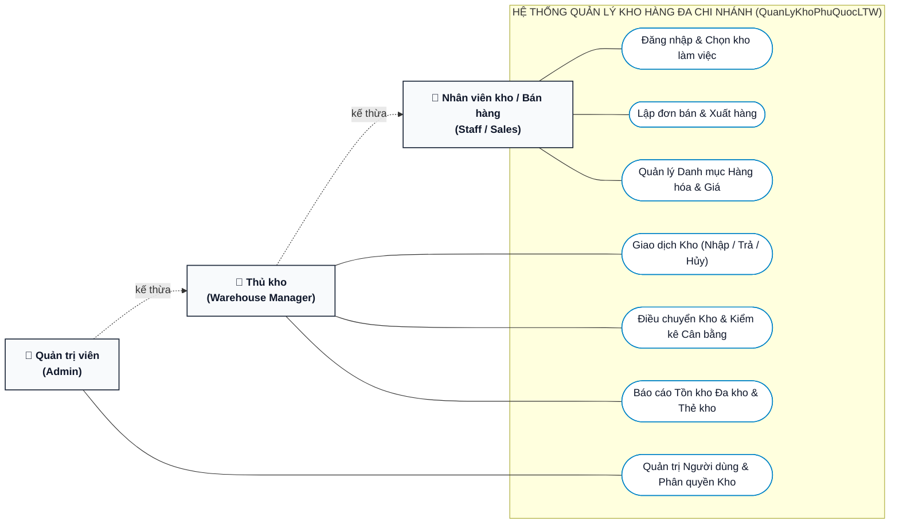
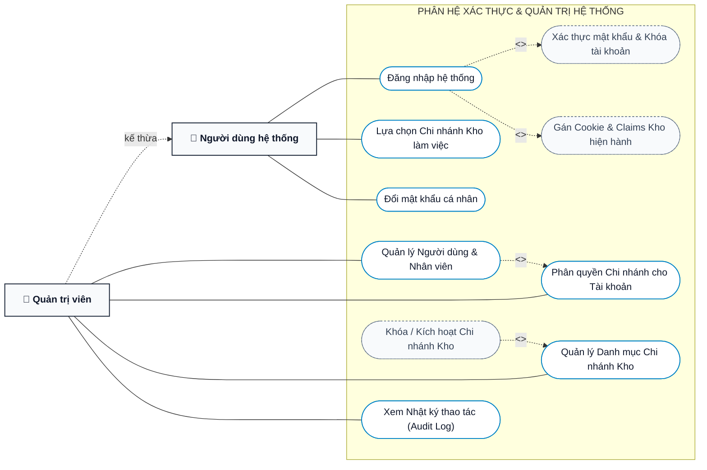
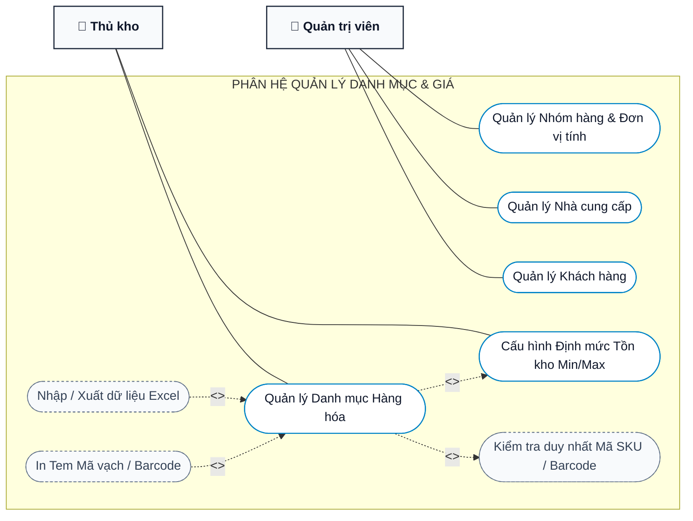
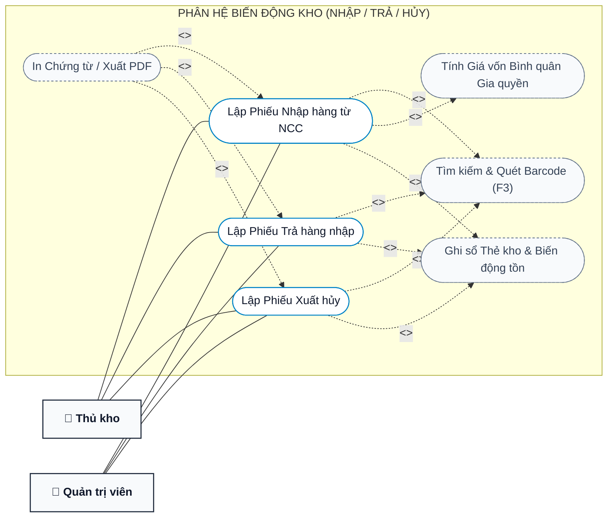
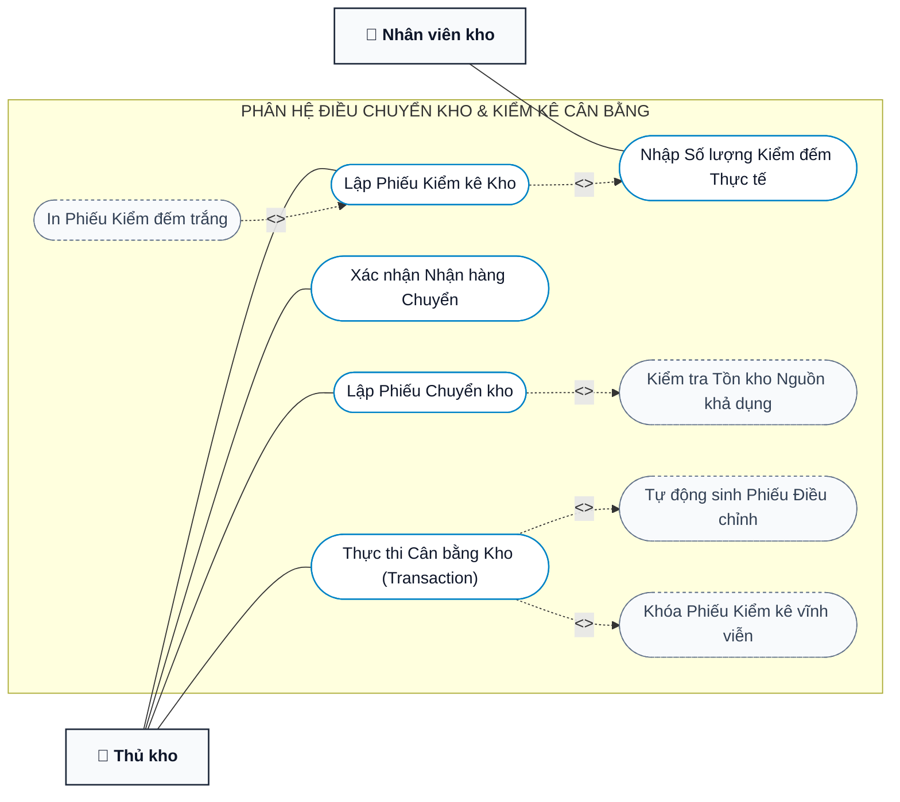
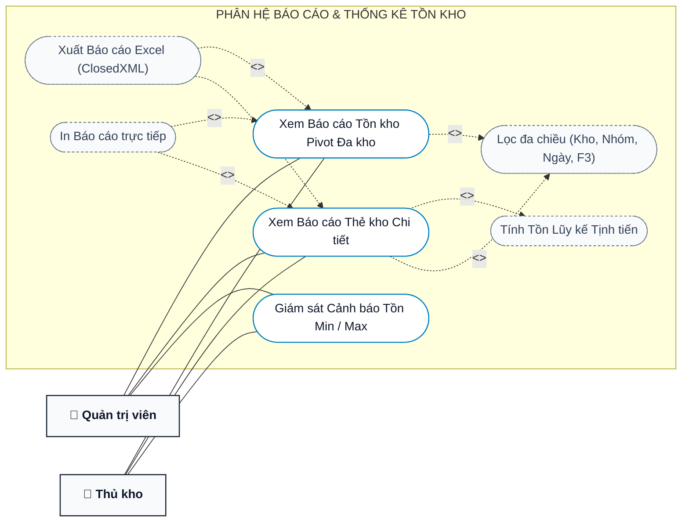

# SƠ ĐỒ USE CASE & MA TRẬN PHÂN QUYỀN HỆ THỐNG (UML)
## Website Quản Lý Kho Hàng Phú Quốc (`QuanLyKhoPhuQuocLTW`)

> **Mục đích tài liệu**: Chuẩn hóa toàn bộ mô hình hóa chức năng hệ thống theo chuẩn UML 2.5 bằng Mermaid, cung cấp hình ảnh chất lượng cao phục vụ Báo cáo học thuật LaTeX (Mục 2.1), bảo vệ đồ án và tài liệu vận hành.

---

## 1. Biểu Đồ Use Case Tổng Quan Cấp Hệ Thống

---

## 2. Biểu Đồ Phân Hệ 1: Xác Thực & Quản Trị Hệ Thống

---

## 3. Biểu Đồ Phân Hệ 2: Quản Lý Danh Mục & Giá Hàng Hóa

---

## 4. Biểu Đồ Phân Hệ 3: Nghiệp Vụ Biến Động Kho (Nhập / Trả / Hủy)

---

## 5. Biểu Đồ Phân Hệ 4: Điều Chuyển Kho & Kiểm Kê Cân Bằng

---

## 6. Biểu Đồ Phân Hệ 5: Báo Cáo & Thống Kê Tồn Kho

